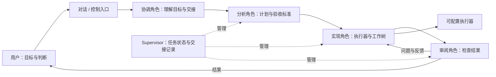
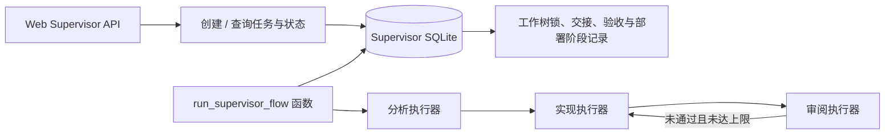
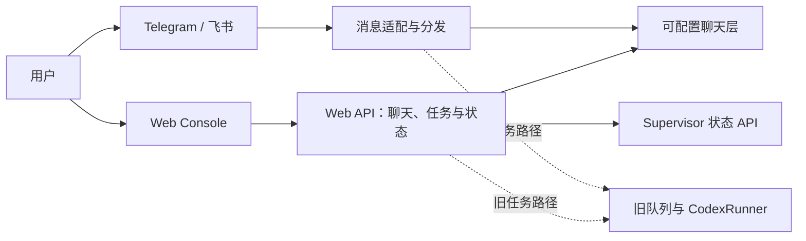

# Conveyor 架构总览：当前代码与演进方向

本文按本工作区源码整理，而非线上部署清单。该说明参考了本地尚未提交的 Supervisor 代码快照；这些代码不包含在本次文档提交中。是否部署、启用以及实际选用的模型，需要以运行环境为准。历史文档中的 Codex 通路仍留在代码中，但不能据此推断用户当前仍在使用 Codex。

## 产品方向：可配置的 Agent 协作

这是目标协作形态，不代表整条链路已在网页上运行。本地角色定义位于 `skills/agent-supervisor.md`，运行时代码位于 `agent_supervisor.py`；两者尚未包含在本次文档提交中。模型和执行器按角色配置，不应将任何单一模型或产品写成项目必需的“大脑”。

## 本地 Supervisor 代码：实际边界

- `run_supervisor_flow` 实现了分析、实现、审阅及有限修复循环；仓库中的 smoke 使用假执行器验证该流程。当前搜索到的调用位于测试脚本，不能把它描述为已接入 Web 的生产闭环。
- Web 的 `/api/supervisor/tasks` 等接口管理任务、状态与部署记录；`dispatch` 更新状态及锁，本身不启动上述执行循环。部署阶段接口记录状态，不等于自动完成部署。
- 当前代码实现了 Claude CLI 执行器；Antigravity 适配器明确返回未实现，Supervisor 内的 Codex 适配器也尚未完成。实际可用性仍取决于环境和配置。不能从角色示例推断线上使用哪家模型。
- 验收记录按 `current_sha` 匹配，不能仅凭同一个 commit SHA 证明未提交工作区内容没有变化；取消、恢复与审阅隔离也不应当描述成已经完整闭环。

## 现存 Web 与历史任务路径

旧路径的存在是源码事实，并非用户现用架构的证明。此前的[页面截图](assets/web-console/desktop.png)使用本工作区的旧 Web 界面与隔离空数据拍摄，界面本身仍显示 Codex 文案，不能当作新 Supervisor 界面或线上部署的截图。桌面能力见 [桌面安全](desktop_security.md) 与 [实时屏幕](live_screen.md)。
