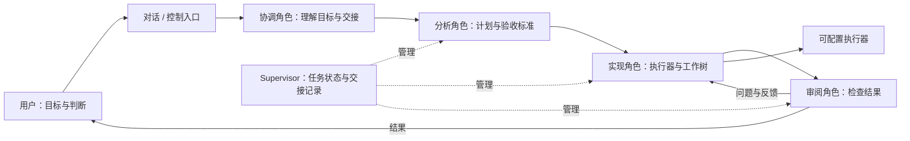
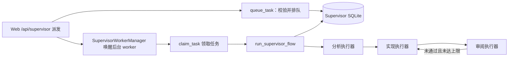
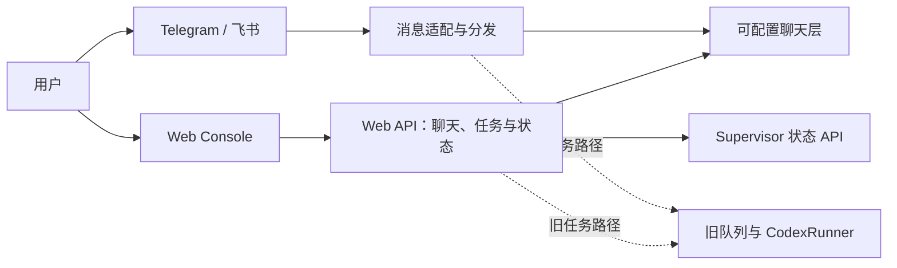

# Conveyor 架构总览：当前代码与演进方向

本文按本分支的源码整理，而非线上部署清单。Supervisor 相关代码已提交在本分支（`work/docs-pool`），但尚未合并到 `main`。是否部署、启用以及实际选用的模型，需要以运行环境为准。历史文档中的 Codex 通路仍留在代码中，但不能据此推断用户当前仍在使用 Codex。

## 产品方向：可配置的 Agent 协作

Supervisor 已接入 Web：在「项目」页派发任务后，服务端的后台 worker 会运行下面的流程（见下一节）。真实执行器与真实任务的端到端验证仍未完成。角色定义位于 `skills/agent-supervisor.md`，运行时代码位于 `conveyor/agents/agent_supervisor.py` 与 `conveyor/agents/supervisor_service.py`。模型和执行器按角色配置，不应将任何单一模型或产品写成项目必需的“大脑”。

## 本地 Supervisor 代码：实际边界

- `run_supervisor_flow` 实现分析、实现、审阅及有限修复循环，并把状态与交接记录写入 Supervisor SQLite。Web 派发后，`conveyor/agents/supervisor_service.py` 中的 `SupervisorWorkerManager` 会唤醒后台 worker，由它领取任务并调用该函数；同时最多运行 2 个流程（`MAX_CONCURRENT_FLOWS`）。worker 首次启动时会执行一次 `recover_on_startup`。
- 仓库中的 smoke（如 `scripts/supervisor_pool_smoke.py`）用假 CLI 走通这一流程。真实模型只在 `scripts/agent_supervisor_live.py --run-real-models` 下运行。
- 接口行为：`dispatch` 返回 202 并唤醒 worker；`cancel` 返回 200 并终止进程组；直接 `transition` 返回 409；部署阶段的浏览器修改返回 409。部署阶段只是数据库记录，不等于自动完成部署。
- 网页入口：「项目」页（`code` 视图，在 `features.agent_supervisor` 开启时显示）；「执行者」页（`workers` 视图）管理执行者池。见 `web/src/App.tsx` 与 `web/src/ux/shellNav.tsx`。
- 当前实现的执行器：`claude`（Claude CLI）、`command-code`、`antigravity`（agy，只读角色使用权限拒绝规则）、`chat`（协调者）和 `pool`（执行者池，见下节）。`codex` 仍是未实现的桩，选用时明确报不可用，不会静默替换。实际可用性仍取决于本机二进制、登录和额度；角色示例不能推断线上使用哪家模型。
- 验收记录按 `current_sha` 匹配，不能仅凭同一个 commit SHA 证明未提交工作区内容没有变化；取消、恢复与审阅隔离也不应当描述成已经完整闭环。

## 执行者池与用量

执行者池（`conveyor/agents/agent_supervisor_pool.py`）只决定由哪个执行者运行，实际执行仍交给对应的 Supervisor 适配器。

- 池里能映射到 Supervisor 适配器的只有 Claude Code、Antigravity（agy）和 Command Code（cmd）。Pi、Super Grok 和 Codex 不参与 Supervisor 执行。
- 候选顺序取页面上的拖动优先级；超过用量阈值（默认 95%）的执行者排到后面。运行中不会因阈值而切换。
- 只有额度类失败才会换下一个执行者。失败的执行者进入冷却，时长取解析到的重置时间，否则为 45 分钟。其他失败直接结束，不轮换。
- 实现角色如果已经改动了工作树，不会在另一个执行者上重跑。
- 用量由 `conveyor/agents/worker_usage.py` 读取。Claude 使用本机凭据；Antigravity 需要本机正在运行的 Antigravity 语言服务进程。
- 冷却状态与聊天使用的执行者池共享（`runner/pooled.py`）。

## 现存 Web 与历史任务路径

旧路径的存在是源码事实，并非用户现用架构的证明。此前的[页面截图](assets/web-console/desktop.png)使用本工作区的旧 Web 界面与隔离空数据拍摄，界面本身仍显示 Codex 文案，不能当作新 Supervisor 界面或线上部署的截图。桌面能力见 [桌面安全](desktop_security.md) 与 [实时屏幕](live_screen.md)。
