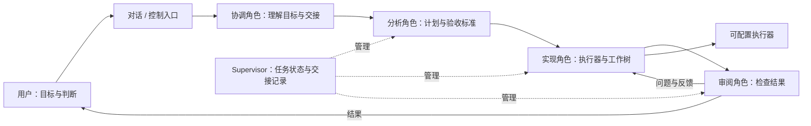
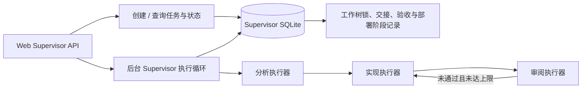
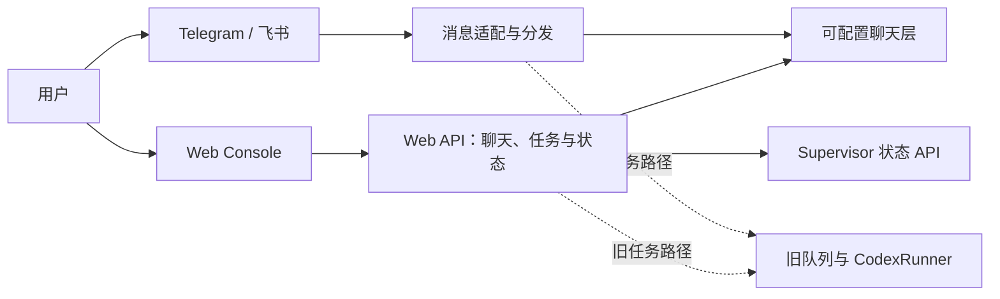

# Conveyor 架构总览：当前代码与演进方向

本文按本工作区源码整理，而非线上部署清单。该说明参考了本地尚未提交的 Supervisor 代码快照；这些代码不包含在本次文档提交中。是否部署、启用以及实际选用的模型，需要以运行环境为准。历史文档中的 Codex 通路仍留在代码中，但不能据此推断用户当前仍在使用 Codex。

## 产品方向：可配置的 Agent 协作

这是目标协作形态，不代表整条链路已在网页上运行。本地角色定义位于 `skills/agent-supervisor.md`，运行时代码位于 `agent_supervisor.py`；两者尚未包含在本次文档提交中。模型和执行器按角色配置，不应将任何单一模型或产品写成项目必需的“大脑”。

## 本地 Supervisor 代码：实际边界

- Web 的“自动任务”和 `dispatch` API 会启动后台分析、实现、命令验证、审阅和有限修复循环。需要启用 Supervisor；可自动识别部分项目的基础测试或手动提供验证命令。可指定独立且干净的现成 Git worktree，否则自动从仓库当前提交创建。任务详情包含交接和有效验收；部署阶段接口仍只记录状态，不代表自动部署。
- 这个旧分支中实现了 Claude CLI 执行器，实际可用性取决于二进制、认证和配置。Codex 和 Antigravity 适配器尚未实现。审阅执行器配置为只读，Claude 仅允许只读工具。
- 验收绑定 HEAD、索引、工作树差异及非忽略的未跟踪文件的快照，变动后失效。含子模块的工作区目前拒绝执行，Git 忽略文件不在快照范围内。旧的仅 SHA 验收不再视为有效。
- 取消会终止由运行时启动的进程组后释放锁；异常或重启后的进程状态不明时应保留锁，当前尚无自动重连和人工解锁界面，也不会自动恢复任务。

## 现存 Web 与历史任务路径

旧路径的存在是源码事实，并非用户现用架构的证明。此前的[页面截图](assets/web-console/desktop.png)使用本工作区的旧 Web 界面与隔离空数据拍摄，界面本身仍显示 Codex 文案，不能当作新 Supervisor 界面或线上部署的截图。桌面能力见 [桌面安全](desktop_security.md) 与 [实时屏幕](live_screen.md)。
